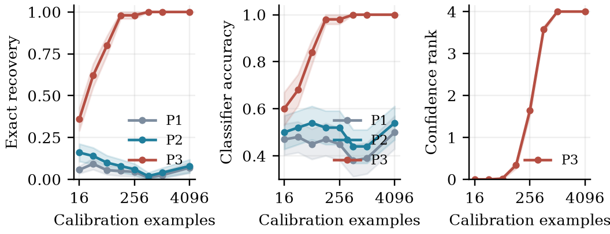

# ParityRepair

Reproducible research software for **identifying and repairing fixed coordinate reflections before a frozen classifier**.

The target inputs satisfy `z = signs * x` in a fixed source-standardized coordinate system. The repair functions consume source/target feature moments, never target class labels. Bounded mixed moments transform by binary parity. The code implements an approximate weighted moment estimator, source-only moment-order selection, and a separate conservative confidence system.

The scope is deliberately restricted. Higher-order moment matching, sign synchronization and binary linear algebra are established ideas. This artifact investigates their specialized use for feature reflection repair and records failures as well as successes. It does not establish universal novelty, patentability, field reliability, or superiority to general test-time adaptation methods.

## Results

At 32 calibration examples on five deduplicated public datasets, twenty splits each, and six fault masks per split, dataset-equal MLP accuracy was:

| Method | Accuracy |
|---|---:|
| Unrepaired | 54.7% |
| Marginal quantile matching | 73.9% |
| Input-space CORAL | 54.5% |
| Fixed P2 | 80.4% |
| Fixed P3 | 82.4% |
| Source-selected ParityRepair | 81.8% |
| Known-sign inversion | 86.5% |

The selector does **not** dominate fixed P3. Third-order aggregation harms some datasets at small batch sizes. On the four-feature separating distribution, fixed P3 recovered every tested reflection at 512 calibration examples; conservative full-rank identification required larger batches. Added offsets and noise can defeat repair because they violate the reflection model.



## Reproduce

Python 3.12 was used. From the repository root:

```sh
python3 -m venv .venv
.venv/bin/python -m pip install -r requirements.txt
.venv/bin/python -m pytest -q
.venv/bin/python src/run_experiments.py --seeds 20 --start-seed 200 --out results/final --cache data
.venv/bin/python src/synthetic.py
.venv/bin/python src/stress.py
.venv/bin/python src/solver_audit.py
.venv/bin/python src/analyze.py
```

`run_experiments.py` takes about seven minutes in the recorded local execution; hardware and library versions affect runtime. The generated CSVs preserve split, batch, fault-mask, classifier and method identifiers. `src/analyze.py` regenerates tables, figures and summary numbers from raw results. Existing frozen outputs are included, so plotting does not require rerunning the models.

Source fitting, independent reference statistics, target calibration, and final test records are disjoint within each split. Approximately 50/20/10/20% partitions are stratified. Source standardization is fitted on the first partition. Calibration batch sizes are nested; masks and repeated splits are correlated. Aggregate masks within splits before estimating split variability. The reported standard errors are descriptive, not population generalization guarantees.

The source-only selector uses eight resampling episodes on source fitting features, known artificial sign masks, and coordinate-recovery error. It never reads real target labels. It retains a chosen degree and source moment summaries for deployment. The point estimator is heuristic; the confidence-set construction has a different purpose and does not certify every point estimate.

## Artifact layout

- `src/parityrepair.py`: moment probes, GF(2) elimination, weighted estimator, confidence system, source-only order selection.
- `src/data.py`: official UCI downloads, duplicate removal and hashes.
- `src/run_experiments.py`: final tabular experiments; MLP and logistic regression.
- `src/synthetic.py`: all 16 reflections of the four-feature separating distribution, 50 independent seeds.
- `src/stress.py`: controlled offsets and noise violating the assumed mechanism.
- `src/solver_audit.py`: exhaustive objective comparison on 60 low-dimensional instances.
- `src/analyze.py`: deterministic result aggregation, manuscript tables and three figures.
- `tests/`: six mathematical/software checks, including exhaustive coset checks for 140 systems.
- `results/final/`: final evaluations, seeds 200–219; **only these tabular runs enter the main reported results**.
- `results/main/` and `results/real.csv`: exploratory development runs, excluded from final comparisons.
- `results/data_manifest.json`: original download hashes and deduplicated dataset sizes.

## Data and references

Datasets are downloaded from the [UCI Machine Learning Repository](https://archive.ics.uci.edu/). UCI identifies them as CC BY 4.0; download archives are not bundled.

- Cortez et al., Wine Quality (2009), [doi:10.24432/C56S3T](https://doi.org/10.24432/C56S3T). Two binary tasks use quality >= 6.
- Lohweg, Banknote Authentication (2013), [doi:10.24432/C55P57](https://doi.org/10.24432/C55P57).
- Sigillito et al., Ionosphere (1989), [doi:10.24432/C5W01B](https://doi.org/10.24432/C5W01B). Constant zero column removed.
- Wolberg et al., Breast Cancer Wisconsin (Diagnostic) (1993), [doi:10.24432/C5DW2B](https://doi.org/10.24432/C5DW2B). Loaded through scikit-learn.

Relevant prior work includes [CORAL](https://doi.org/10.1609/aaai.v30i1.10306), [CMD](https://arxiv.org/abs/1702.08811), [HoMM](https://doi.org/10.1609/aaai.v34i04.5745), [synchronization](https://doi.org/10.1016/j.acha.2010.02.001), [Boolean Fourier analysis](https://arxiv.org/abs/2105.10386), [orbit recovery](https://arxiv.org/abs/1712.10163), [TabLog](https://proceedings.mlr.press/v235/ren24b.html), and [PFT3A](https://openreview.net/forum?id=BgSDPE24pa).

Research software and experiments: Shivam Gupta. This repository is an experimental artifact; no publication acceptance is claimed.
